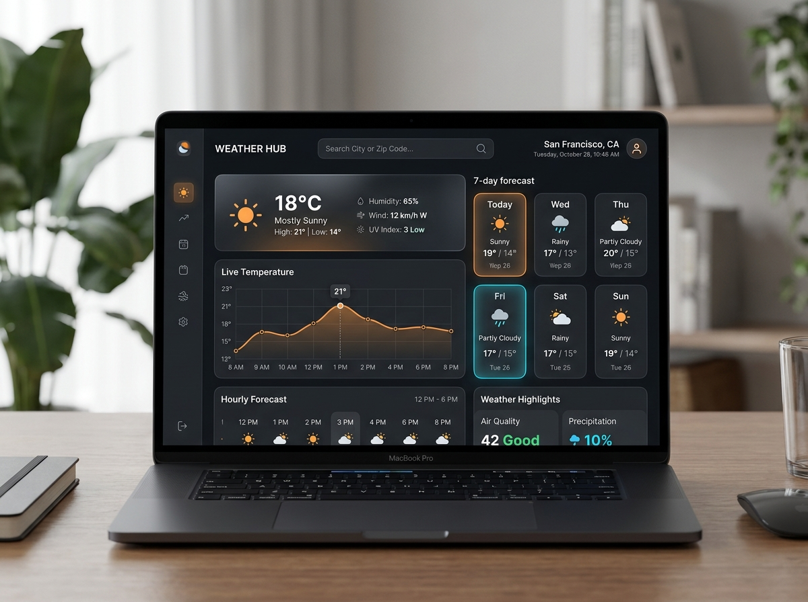

# Amarjeet Rout — Web Developer Portfolio

A modern, high-performance, cinematic Web Developer Portfolio featuring custom canvas-rendered 24fps scroll animations, dark luxury aesthetics, glassmorphism, and responsive design.



## 👤 About Amarjeet Rout
- **Role:** Web Developer / Full Stack Developer
- **Education:** B.Tech in Computer Science and Engineering, GITA Autonomous College, Bhubaneswar
- **Email:** [amarjeetrout250@gmail.com](mailto:amarjeetrout250@gmail.com)
- **Phone:** +91 9938787614
- **Location:** Bhubaneswar, Odisha, India
- **GitHub:** [https://github.com/AMARJEETROUT](https://github.com/AMARJEETROUT)
- **LinkedIn:** [https://www.linkedin.com/in/amarjeet-rout-613867258](https://www.linkedin.com/in/amarjeet-rout-613867258)

---

## 🛠️ Core Tech Stack & Tools
- **Languages:** Python, JavaScript (ES6+), HTML5, CSS3
- **Frameworks & Libraries:** React.js, Node.js, Express.js, Django
- **Databases:** MySQL, MongoDB
- **Architecture & APIs:** RESTful APIs, MVC, Microservices
- **Tools & Platforms:** Git, GitHub, Docker, VS Code

---

## 🚀 Featured Projects & Experience
1. **Weather Forecasting Application**
   - Real-time weather forecasting platform with dynamic API integration, forecast cards, and meteorological data visualizers.
   - *Tech:* JavaScript, REST APIs, HTML5 & CSS3
2. **Online Quiz Management System**
   - Full-stack quiz platform featuring dynamic randomized question rendering, automated countdown timers, and instant grading metrics.
   - *Tech:* Full Stack, JavaScript, MySQL
3. **Python Full Stack Internship • OCAC**
   - Engineered full-stack web solutions at Odisha Computer Application Centre utilizing Python, Django, REST endpoints, and relational databases.
   - *Tech:* Python, Django, MySQL, REST APIs
4. **Web Development Internship • Technochanet**
   - Built responsive UI components, modular frontend structures, backend integrations, and collaborated via Git workflows.
   - *Tech:* React, Node.js, Git, Web Development

---

## 💻 Key Features
- **Cinematic Canvas Frame Sequence:** 192 ultra-smooth high-definition frames synchronized with scroll progress via an inertial Lerp loop.
- **Interactive Scrubber HUD:** Minimalist bottom timeline scrubber showing sequence progress, current frame counter, and drag/click seeking.
- **Glassmorphic UI Design:** Tailored dark luxury color palette (`#080808`, `#161311`), radial vignettes, and subtle ambient orange backlighting.
- **Fully Responsive Layout:** Optimized for mobile, tablet, and ultra-wide desktop viewports.
- **Zero External CSS Frameworks:** Built with pure semantic HTML5, Vanilla CSS, and modular JavaScript for maximum speed and zero dependency bloat.

---

## 📦 Local Development Setup

To run this portfolio locally:

```bash
# Clone the repository
git clone https://github.com/CODE-Amar07/Amarjeet-Portfolio.git

# Navigate to the project directory
cd Amarjeet-Portfolio

# Run using the built-in PowerShell server (Windows)
powershell -ExecutionPolicy Bypass -File server.ps1

# Or run using any static file server, for example:
# npx serve .
# python -m http.server 3000
```

Open your browser and navigate to:
```
http://localhost:3000/
```

---

## 📄 License
© 2026 Amarjeet Rout. All rights reserved.
